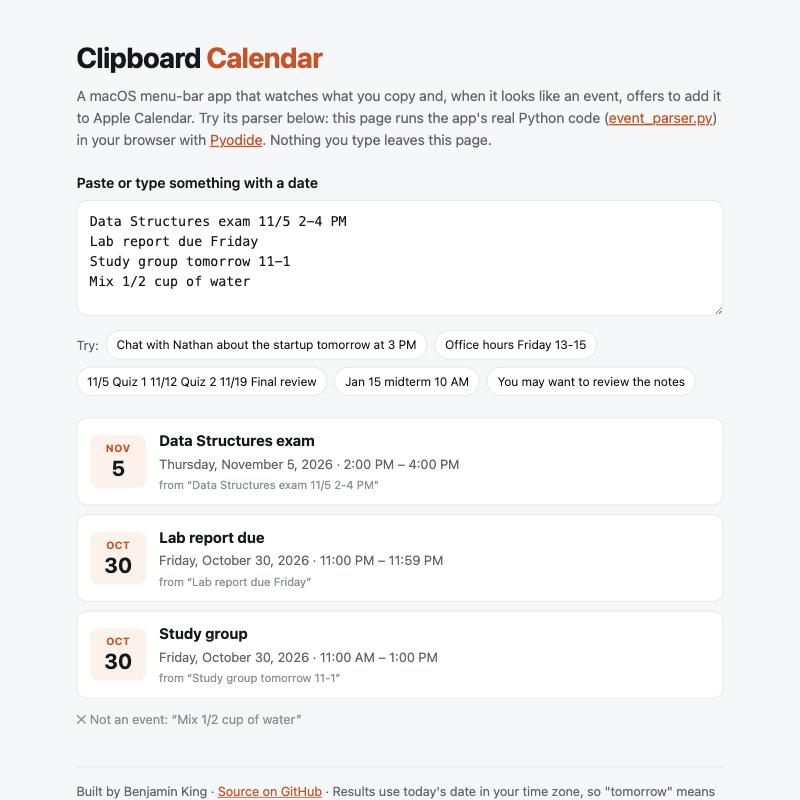

# Clipboard Calendar

[](https://github.com/kinger56/clipboard-calendar/actions/workflows/ci.yml)

**Copy text that mentions an event, and it offers to add it to Apple Calendar.**

A macOS menu-bar app: copy `Data Structures exam 11/5 2-4 PM` from an email, syllabus or
course page, and a prompt asks whether to add **"Data Structures exam", Thu Nov 5, 2:00–4:00 PM**
to your calendar, with the title editable first.

**[▶ Try the parser in your browser](https://kinger56.github.io/clipboard-calendar/)**: the demo
runs the app's real Python parser with Pyodide (WebAssembly). Nothing you type leaves the page.

<p align="center"></p>

## Why I built it

<!-- Make this yours: add a sentence about why you wanted this. -->
Deadlines and events show up everywhere: emails, syllabi, group chats, course pages. Copying each
one into a calendar by hand is tedious, so they get missed. Since I copy that text anyway, I wanted
the copy itself to be enough.

## Features

- **Finds events in copied text:** dates like `11/5`, `Nov 5th`, `tomorrow`, `next Friday`;
  times like `2-4 PM`, `11-1`, `13:00-15:00`, `9:15am`, `2p`
- **Asks before adding**, with an editable title (can be turned off from the menu)
- **Handles lists:** one event per line, and syllabus rows like `11/5 Quiz 1 11/12 Quiz 2`
- **Skips duplicates** and text that only looks date-like (`1/2 cup`, "you *may* want")
- **Menu-bar controls:** start/stop, see upcoming events, live 🟢/🔴 status

## How it works

```
clipboard ──► split_events ──► parse_event ──► duplicate? ──► Add / Ignore ──► Apple Calendar
  (every 2 s)   one piece per      date, time,      skip if       prompt with      via AppleScript
                line / date        title            already added  editable title
```

| File | Role |
|---|---|
| `event_parser.py` | Pure parsing logic (no macOS dependencies, which is why it can run in a browser) |
| `main.py` | Watches the clipboard and connects the pieces |
| `confirm_dialog.py`, `calendar_manager.py`, `notification_manager.py` | AppleScript: prompt, add event, notify |
| `menu_app.py`, `service.py` | Menu-bar app; start/stop through macOS's service manager (`launchctl`) |
| `settings.py` | Settings shared by the menu and the assistant (`settings.json`) |

**Parsing** uses explicit regular expressions with word boundaries, not a date-guessing library,
so every rule can be explained and tested. Times without AM/PM are inferred: `2-4` is afternoon,
`9-11` is morning, and `11-1` crosses noon. A date with no year that has already passed is assumed
to mean next year.

## Privacy and security

A clipboard app sees everything you copy, so these were design requirements:

- **Copied text is never logged.** The log records only actions ("added event on 2026-11-05"),
  is capped at 1 MB, and never leaves your Mac.
- **No AppleScript injection.** Copied text can come from any web page, so it's never pasted into
  AppleScript source. The scripts are fixed, and text goes in as separate arguments (`argv`), so it can
  only ever be data, never code.
- **Nothing is added without asking** unless you turn the prompt off.
- Logs, saved events and settings are excluded from git.

## What I fixed in version 2

I wrote the first version in May 2026. Reviewing it later, I found and fixed real problems, each
now covered by a test:

- **Privacy:** every copied item, including anything sensitive, was being written to a log file that grew to 12 MB
- **Security:** copied text was inserted into AppleScript source, so crafted text could run commands
- **Reliability:** "Stop" didn't stop, because macOS restarted the process; the fix controls it through `launchctl`
- **Parsing:** "Data Structures" became "Da Structures"; `11-1` ended at 1 AM; `13/45` and 24-hour
  times crashed; "1/2 cup" became an event; January–April were never recognized; titles before a
  date were dropped

## Install (macOS)

Requires macOS and Python 3.9+.

```bash
git clone https://github.com/kinger56/clipboard-calendar.git
cd clipboard-calendar
./install.sh
```

Then create a calendar named **Clipboard Calendar** in the Calendar app (File → New Calendar)
and look for 📋 in the menu bar. The first time, macOS asks to allow Calendar access: click OK.
`./uninstall.sh` removes it.

## Development

```bash
python3 -m venv venv && source venv/bin/activate
pip install -r requirements-dev.txt
python -m pytest -v
```

52 tests, including a property-based test (Hypothesis) that feeds hundreds of random date-like
strings to the parser and checks it never crashes or produces an event that ends before it starts.
CI runs the tests on macOS and, if they pass, publishes the web demo with the current parser.

**Tech stack:** Python · AppleScript · launchd · rumps (menu bar) · pytest + Hypothesis ·
Pyodide (WebAssembly) · GitHub Actions + Pages

## What I'd add next

- **Undo the last event** from the menu
- **Google Calendar / .ics export**, so it isn't tied to Apple Calendar
- **Locations:** pick up "in room 204" or a Zoom link and fill in the event's location
- React to clipboard changes instantly using macOS's pasteboard change counter, instead of checking every 2 seconds
